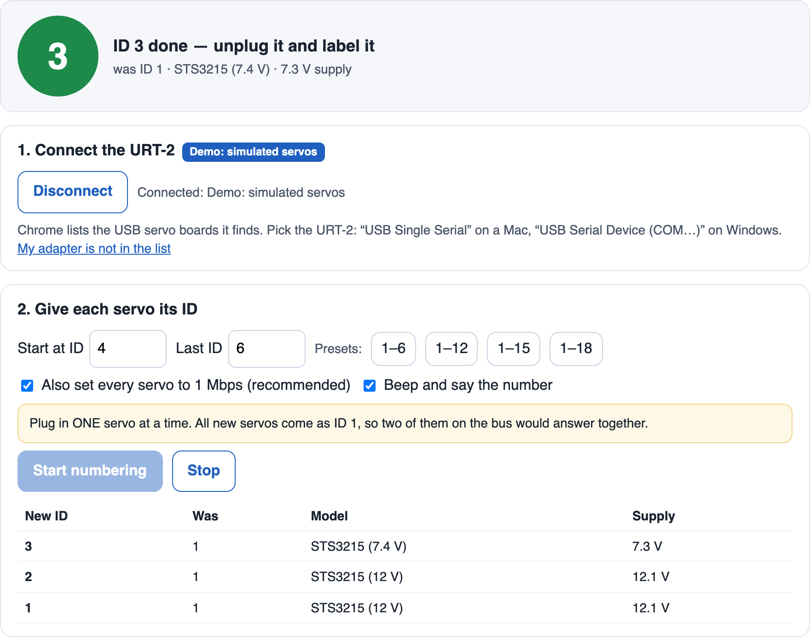

# ArmDojo Servo ID Tool

A free browser tool that sets the IDs of **Feetech STS3215, STS3250 and SCS-series bus servos** over Web Serial. Nothing to install: plug a USB servo board into your computer, open the page in Chrome or Edge and number your servos one by one.

**▶ Use it now: [armdojo.com/pages/servo-id-tool](https://armdojo.com/pages/servo-id-tool?utm_source=github&utm_medium=referral&utm_campaign=servo-id-tool)**. It is free, runs in 20 languages, and comes with setup help and an FAQ.

[](https://armdojo.com/pages/servo-id-tool?utm_source=github&utm_medium=referral&utm_campaign=servo-id-tool)
[](https://armdojo.com/collections/bus-servos-drivers?utm_source=github&utm_medium=referral&utm_campaign=servo-id-tool)
[](LICENSE)
[](https://discord.gg/MdyRuJVFAm)

<p align="center"></p>

## Why

Every new Feetech bus servo leaves the factory as **ID 1**. Before you chain servos together, each one needs its own ID. That applies to an SO-101 / LeRobot arm, a robot dog with 12 servos or a 15-servo duck biped. Otherwise two servos answer at once and nothing on the bus works.

The usual ways to do this need extra software:
- Feetech's FD program, which runs on Windows only;
- or a Python install with LeRobot's `lerobot-setup-motors`.

This tool does the same job in a browser tab, on Windows, macOS, Linux and ChromeOS.

## What it does

- **Numbers servos one at a time.**
  - Plug in a servo: it gets the next ID (0–253), is switched to 1 Mbps and is read back.
  - The page beeps and says the number. Unplug it, label it, plug in the next one.
  - Presets: 1–6 for an arm, 1–12 for a dog, 1–15 and 1–18.
- **Microduck preset for HD-1910 builds.**
  - Numbers the 15 servos in the Microduck joint order: 10–14 right leg, 20–24 left leg, 30–34 neck, head and beak.
  - Shows the joint for every ID, so you know what to write on the label.
  - Switches on over-current and over-voltage protection in each servo (register 19, bits 8 and 1). Both are off from the factory; over-temperature stays on.
- **Finds a servo at any baud rate**: 1 M, 500 k, 250 k, 128 k, 115.2 k, 76.8 k, 57.6 k or 38.4 kbps.
- **Stops when two servos answer together** (duplicate IDs) and asks you to leave only one on the bus.
- **Checks the whole chain**: scans IDs 0–253 at 1 Mbps and lists the model, supply voltage and protection settings of each servo, so missing or duplicate IDs stand out. Run it after a power cycle to confirm that the IDs and protection were saved.
- **Centers a servo** at position 2048 before you fit a horn.
  - It holds the current position first, then moves at 30 % torque, stepping the goal itself at about 35°/s (HD-1910s ship in a PD mode that may ignore the speed register).
  - It refuses to run when the servo has no external supply (below 6 V).
- **Sends nothing over the internet.** All servo traffic stays between the browser and the USB board.

## Hardware

| | |
|---|---|
| **Board (tested)** | [Feetech FE-URT-2 USB servo board](https://armdojo.com/products/feetech-fe-urt-2-usb-ttl-rs485-servo-debug-board?utm_source=github&utm_medium=referral&utm_campaign=servo-id-tool). Its USB power is enough to change IDs. Wire the servo to the TTL (3-pin) port. |
| **Other boards** | USB-to-TTL bus servo boards with a CH34x, CP210x, FTDI or PL2303 chip appear in the port list and usually work, but only the FE-URT-2 is tested. If your board's USB does not power the servo port, switch on the servo supply. |
| **Servos** | [Feetech STS3215](https://armdojo.com/products/feetech-sts3215-serial-bus-servo?utm_source=github&utm_medium=referral&utm_campaign=servo-id-tool) (7.4 V and 12 V versions), STS3250, SCS series and the [HD-1910-C001](https://armdojo.com/products/feetech-hd-1910-c001-coreless-servo-microduck?utm_source=github&utm_medium=referral&utm_campaign=servo-id-tool) (model 7946, tested on a real servo). Other Feetech servos on the same protocol are numbered too and shown by their model number. |
| **Power for centering** | A supply at the servo's voltage (7.3 V for 7.4 V servos, 12 V for 12 V servos), e.g. our [adjustable 3–12 V 5 A supply](https://armdojo.com/products/servo-power-adapter-12v-5a-dc-5-5x2-1?utm_source=github&utm_medium=referral&utm_campaign=servo-id-tool). |
| **Browser** | Google Chrome or Microsoft Edge on a computer. Safari, Firefox and phone browsers cannot open USB serial ports. |

New to Feetech servos? Our [servo setup guide](https://armdojo.com/blogs/guides/feetech-servo-setup-guide-fe-urt-2-wiring-voltage-ids?utm_source=github&utm_medium=referral&utm_campaign=servo-id-tool) covers wiring, voltage and IDs. The [Robot Builder FAQ](https://armdojo.com/blogs/guides/robot-builder-faq-feetech-servos-microduck-robot-dog?utm_source=github&utm_medium=referral&utm_campaign=servo-id-tool) has the common questions.

## How it works

Feetech servos use a half-duplex serial protocol: `FF FF ID LEN INSTR PARAMS… CHK`, where `LEN = params + 2` and `CHK = ~(ID + LEN + INSTR + params) & 0xFF`.

Changing an ID takes these steps:
1. Find the single servo with a broadcast PING, trying every baud rate. A garbled reply means two servos are answering, so the tool stops.
2. Read the model and the max-voltage register to tell the STS3215 7.4 V and 12 V versions apart.
3. Unlock the EEPROM (register 55; 48 on SCS).
4. Write the new ID to register 5. The acknowledgement still comes from the old ID.
5. Lock the EEPROM again under the new ID.
6. Optionally write register 6 to set 1 Mbps.
7. Optionally switch on protection bits in register 19 the same way: unlock, write, lock, read back.
8. Read the ID back, and confirm that nothing answers on the old ID any more.
9. Wait until the servo is unplugged before numbering the next one.

The code handles boards that echo what they send, resyncs after line noise, and treats a reply from the wrong ID or a bad checksum as a collision. `src/core.js` has no browser APIs, so the whole flow runs in Node against simulated servos (`src/mock.js`).

## Files

| Path | What it is |
|---|---|
| `src/core.js` | Protocol, bus transactions, scan, identify, change ID and baud rate, center, and the one-at-a-time numbering flow. |
| `src/mock.js` | Simulated STS3215 and HD-1910 servos. Their EEPROM keeps a write over a power cycle only if it was made while unlocked, as on the real servos. Used by the tests and by demo mode. |
| `src/ui.js` | Web Serial link and the page UI. It mounts into `<div id="armdojo-servo-tool">`. |
| `i18n/<lang>.json` | UI text in 20 languages: bg, cs, da, de, el, en, es, fi, fr, hu, it, ja, ko, nb, nl, pl, pt-PT, ro, sk, sv. |
| `build.py` | Bundles everything into `dist/servo-id-tool.v<N>.js` and checks that every language has the English keys and placeholders. |
| `test/test.js` | 36 protocol and numbering checks against simulated servos. |
| `example.html` | Minimal page for local testing. |

## Run it locally

```bash
node test/test.js                  # 36 checks against simulated servos
python3 build.py 2                 # writes dist/servo-id-tool.v2.js
python3 -m http.server 8765 --bind 127.0.0.1
# open http://localhost:8765/example.html?servo-demo=1   (demo with simulated servos)
# open http://localhost:8765/example.html                (real board)
```

Web Serial only works on `https://` pages or on `localhost`. The page language follows `data-lang` on the container, then `<html lang>`, then English.

Translation fixes and bug reports are welcome as issues or pull requests.

## Parts and help

- 🛒 [Feetech FE-URT-2 USB servo board](https://armdojo.com/products/feetech-fe-urt-2-usb-ttl-rs485-servo-debug-board?utm_source=github&utm_medium=referral&utm_campaign=servo-id-tool)
- 🛒 [Feetech STS3215 bus servos](https://armdojo.com/products/feetech-sts3215-serial-bus-servo?utm_source=github&utm_medium=referral&utm_campaign=servo-id-tool) and [all bus servos and drivers](https://armdojo.com/collections/bus-servos-drivers?utm_source=github&utm_medium=referral&utm_campaign=servo-id-tool)
- 🛒 [Feetech HD-1910-C001 servos](https://armdojo.com/products/feetech-hd-1910-c001-coreless-servo-microduck?utm_source=github&utm_medium=referral&utm_campaign=servo-id-tool)
- 🛒 [SO-ARM101 / SO-101 robot arm kits](https://armdojo.com/products/so-arm101-lerobot-robot-arm-kit?utm_source=github&utm_medium=referral&utm_campaign=servo-id-tool)
- 📖 [Feetech servo setup guide: wiring, voltage, IDs](https://armdojo.com/blogs/guides/feetech-servo-setup-guide-fe-urt-2-wiring-voltage-ids?utm_source=github&utm_medium=referral&utm_campaign=servo-id-tool)
- 💬 [ArmDojo Discord](https://discord.gg/MdyRuJVFAm) for build help, or email info@armdojo.com

Everything ships from Singapore with tracking.

More from ArmDojo: [armdojo/so-arm101](https://github.com/armdojo/so-arm101) (SO-101 arm files), [armdojo-hardware](https://github.com/miraclewhite-tech/armdojo-hardware) (printable 5-axis arm), [armdojo-duck](https://github.com/miraclewhite-tech/armdojo-duck) (HD-1910 duck build notes).

## License

[CC BY-NC-SA 4.0](LICENSE), © ArmDojo.
- **Allowed:** free use, sharing and modification for personal, educational and research projects, with attribution. Derivatives must use the same license.
- **Commercial use:** for example bundling the tool with products you sell or hosting it on a shop. Ask us first at info@armdojo.com.
